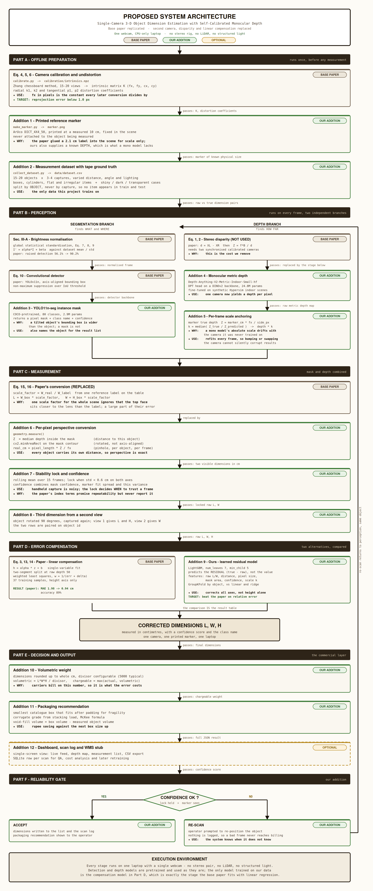

# Dimension Estimation

Measuring the real-world size of an object from a single ordinary camera.

Show an object to a webcam and the system returns its length, width and height in
centimetres — no stereo rig, no depth sensor, no laser scanner.

---

## Overview

Accurate dimension measurement matters wherever objects are packed and shipped, because
carriers bill on volumetric weight rather than actual weight. Commercial dimensioning
systems achieve this with LiDAR or structured light, and research systems typically use a
calibrated stereo camera pair. Both add hardware cost and setup burden.

This project takes a different route: one camera, two pretrained neural networks, a printed
reference marker placed in the scene, and a small correction model trained on locally
measured objects. The pipeline runs on an ordinary laptop with no GPU requirement.

## How the system works



**Offline preparation.** The camera is calibrated once with a chessboard pattern to recover
its focal length and lens distortion. A reference marker is printed at a measured physical
size and fixed in the scene — never attached to the object. A dataset of everyday objects
is then captured alongside tape-measured ground truth, which is the only data the project
trains on.

**Perception.** Each frame runs through two independent branches. A segmentation model
produces a pixel-accurate mask of the object along with its class name, which is more
precise than a bounding box because a tilted object's bounding box is wider than the object
itself. In parallel, a monocular depth model estimates distance for every pixel — the stage
that replaces the second camera entirely.

**Scale anchoring.** Monocular depth models are trained on synthetic data under assumed
camera geometry, so their absolute scale drifts on an unseen webcam. The marker's true
distance is computed from its known printed size and compared against the model's
prediction at the same pixels, yielding a correction factor that is refitted on every
frame. Moving, bumping or swapping the camera therefore cannot silently corrupt results.

**Measurement.** A rotated minimum-area rectangle is fitted to the mask and converted to
centimetres using that object's own measured distance, so perspective is handled per object
rather than through one global scale factor. Readings are averaged over a short window and
locked once they settle, which keeps handheld capture usable. The third dimension comes
from a second view with the object rotated 90°.

**Error compensation.** Systematic error remains after the geometry — from lens effects,
mask edges and depth model bias. A gradient-boosted model learns the residual between raw
estimates and tape-measured truth, validated by object so that no item appears in both
training and testing. This is benchmarked against the linear regression used in prior work.

**Decision and output.** Final dimensions produce volumetric weight and a packaging
recommendation: the smallest suitable box, padding for fragility, and the resulting cost
difference. Every measurement carries a confidence score, and readings that fail the
confidence gate are rejected and re-scanned rather than silently recorded.

## Scope

Because measurement is driven by a segmentation mask rather than corner detection, the
system is not restricted to boxes — bottles, books and irregular items are handled the same
way. Shiny, transparent and very dark surfaces are the hardest cases for monocular depth
and are treated as known limitations.

## Installation

```bash
git clone git@github.com:muthu-raam-t/dimension-estimation.git
cd dimension-estimation
python3 -m venv .venv && source .venv/bin/activate
pip install -r requirements.txt
```

On Linux, OpenCV also needs a few system libraries:

```bash
sudo apt install -y libgl1 libglib2.0-0 v4l-utils
```

Install only `opencv-contrib-python` — having `opencv-python` alongside it breaks the shared
`cv2` module. Model weights download automatically on first run.

## Usage

```bash
python make_marker.py                              # print the reference marker
python demo_image.py photo.jpg                     # measure from a single image
python calibrate.py                                # one-time camera calibration
python live_demo.py                                # live measurement
python collect_dataset.py --id bottle01 --true 7 22  # capture ground truth
python train_correction.py                         # train and compare correction models
```

## Repository layout

| File | Purpose |
|---|---|
| `config.py` | All tunable settings in one place |
| `models.py` | Loads and runs the segmentation and depth models |
| `geometry.py` | Focal length, marker anchoring, pixel-to-centimetre conversion |
| `demo_image.py` | Full pipeline on a single image |
| `live_demo.py` | Live webcam measurement with a stability lock |
| `calibrate.py` | Chessboard camera calibration |
| `collect_dataset.py` | Captures measurements against tape-measured ground truth |
| `train_correction.py` | Compares linear, ridge and gradient-boosted correction |
| `make_marker.py` | Generates the printable ArUco marker |

## Reference

W. C.-C. Chu, T.-C. Hsu, Y.-C. Cheng and W. Qu, "Improving Reliability of 3-D Parcel
Dimension Estimation Software via Dual-Camera Stereo Vision and Efficient Deep Neural
Networks," *IEEE Transactions on Reliability*, vol. 75, 2026.

## License

MIT
